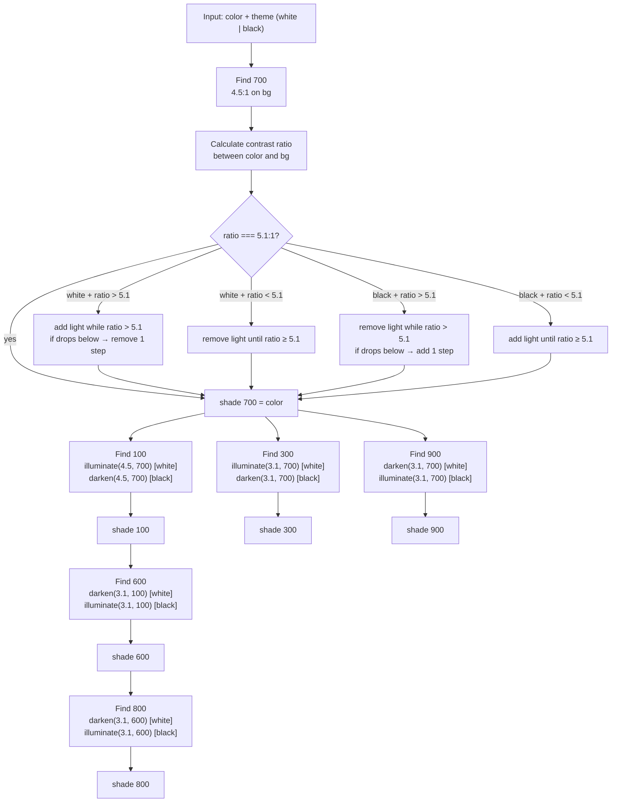

# accessible-color-palette

[](https://www.npmjs.com/package/accessible-color-palette)
[](https://github.com/ceciCoding/accessible-color-palette/blob/main/LICENSE)
[](https://www.npmjs.com/package/accessible-color-palette)
[](https://www.npmjs.com/package/accessible-color-palette)

A TypeScript library that generates **WCAG 2.2 AA compliant monochromatic palettes** from any hex color. The palette algorithm has no external dependencies — the WCAG math is implemented directly.

Given a hex color and a background theme (`'white'` | `'black'`), it produces 6 shades — **100, 300, 600, 700, 800, 900** — where every shade meets contrast requirements against the theme. It also returns a usage map describing which shade pairs pass AA for normal text (4.5:1) and which pass for large text / UI components (3:1).

It also ships an **APCA variant** (the WCAG 3 draft contrast model) with its own derivation chain, directional usage map and CSS manifest — see [APCA variant](#apca-variant-wcag-3-draft).

Ships as an ESM library, a **CLI**, and an **MCP server** for use with AI assistants.

---

## Install

```bash
npm install accessible-color-palette
```

---

## Usage

### As a CLI

```bash
npx accessible-color-palette <hex> <theme> [options]
```

| Argument / Option | Description |
|-------------------|-------------|
| `hex` | Hex color — with or without `#`, 3 or 6 chars |
| `theme` | Background theme: `white` \| `black` |
| `--model <name>` | Contrast model: `wcag2` (default) \| `apca` |
| `--prefix <name>` | CSS variable prefix (default: `color`) |
| `--json` | Output full palette + usage map as JSON |
| `-h, --help` | Show help |

```bash
# CSS tokens with WCAG manifest (default)
npx accessible-color-palette 1F7A54 white

# Custom prefix
npx accessible-color-palette 1F7A54 white --prefix brand

# Raw JSON
npx accessible-color-palette 1F7A54 white --json

# APCA (WCAG 3 draft) palette + directional manifest
npx accessible-color-palette 1F7A54 white --model apca
```

Output (default):

```css
/*
 * WCAG AA PAIRING MANIFEST — source: #1f7a54 · theme: white
 *
 * BODY TEXT (any font size, ≥4.5:1):
 *   shade-700 (#207c55) → white, 100
 *   shade-800 (#124630) → white, 100, 300
 *   ...
 */
:root {
  --color-100: #e3f8ef; /* ✅ text→900·800·700  ⚠️ lg→600 */
  --color-700: #207c55; /* ✅ text→white·100  ⚠️ lg→300·900 */
  ...
}
```

---

### As a library

```ts
import { generatePalette, toCSSTokens } from 'accessible-color-palette'

const result = generatePalette('#1F7A54', 'white')

// Each shade includes hex, RGB and HSL values
console.log(result.palette['700'])
{
  hex: '#1f7a54',
  rgb: { r: 31, g: 122, b: 84 },
  hsl: { h: 152, s: 59, l: 30 }
}

// Usage map: for each shade, which backgrounds pass for normal text and large text
console.log(result.usage['700'].normalText)
[
  { key: '100', hex: '#d6f5e8', ratio: 4.18 },
  { key: 'background', hex: '#ffffff', ratio: 5.10 },
  ...
]

console.log(result.usage['700'].largeText)
[{ key: '300', hex: '#71dbae', ratio: 3.21 }, ...]

// CSS tokens
console.log(toCSSTokens(result))
--color-100: #d6f5e8;
--color-300: #71dbae;
--color-600: #259868;
--color-700: #1f7a54;
--color-800: #10422d;
--color-900: #082116;

// Custom prefix
console.log(toCSSTokens(result, 'brand'))
--brand-100: #d6f5e8;
// ...

// Validate a list of foreground/background shade pairs before you use them
import { validatePairings } from 'accessible-color-palette'

const report = validatePairings(result, [
  { foreground: '700', background: 'white' },
  { foreground: '100', background: '900' },
])
console.log(report.allPass)        // true
console.log(report.pairings[0])    // { level: 'aa-normal', message: '✓ ...', ... }

// Check contrast between any two arbitrary hex colors — e.g. a brand accent
// that isn't part of the generated palette
import { checkContrast } from 'accessible-color-palette'

console.log(checkContrast('#ffffff', '#c75d3a'))
{
  foreground: '#ffffff',
  background: '#c75d3a',
  ratio: 4.15,
  level: 'aa-large',
  message: '⚠ #ffffff on #c75d3a: 4.15:1 — AA large text only (3:1–4.5:1) ...'
}
```

### As an MCP server

Also ships as an MCP server exposing `generate_palette`, `validate_pairings`, `generate_css_tokens`, and `check_contrast` as tools, plus a `palette://{hex}/{theme}` resource and a `plan-palette-usage` guided prompt. Every tool accepts an optional `model: "wcag2" | "apca"` (default `wcag2`). `generate_css_tokens` enforces a server-side gate — it rejects requests for a hex+theme+model until `validate_pairings` has passed for that same combination earlier in the session.

See **[MCP.md](./MCP.md)** for client config, the full tools table, and how the gate and the guided-prompt workflow relate to each other.

---

## Output shape

```ts
interface PaletteResult {
  palette: Record<'100' | '300' | '600' | '700' | '800' | '900', {
    hex: string
    rgb: { r: number; g: number; b: number }  // 0–255
    hsl: { h: number; s: number; l: number }  // h: 0–360, s/l: 0–100
  }>
  usage: Record<'100' | '300' | '600' | '700' | '800' | '900', {
    hex: string
    normalText: Array<{ key: string; hex: string; ratio: number }>
    largeText:  Array<{ key: string; hex: string; ratio: number }>
  }>
  theme: 'white' | 'black'
  sourceColor: string
}
```

- `normalText` — backgrounds where this shade passes at **4.5:1** or better (body text, small UI)
- `largeText` — backgrounds where this shade passes at **3:1–4.49:1** (headings, large text, icons)
- Failing combinations (< 3:1) are omitted entirely
- `key` is a shade (`'100'`–`'900'`) or `'background'` (white or black, depending on theme)

---

## Example output

**`generatePalette('#1F7A54', 'white')`**

| Shade | Hex | RGB | HSL |
|-------|-----|-----|-----|
| 100 | `#e3f8ef` | `227, 248, 239` | `154°, 60%, 93%` |
| 300 | `#78dcb1` | `120, 220, 177` | `154°, 59%, 67%` |
| 600 | `#279c6a` | `39, 156, 106` | `154°, 60%, 38%` |
| 700 | `#207c55` | `32, 124, 85` | `155°, 59%, 31%` |
| 800 | `#124630` | `18, 70, 48` | `155°, 59%, 17%` |
| 900 | `#0a2519` | `10, 37, 25` | `153°, 57%, 9%` |

**`generatePalette('#239062', 'black')`** — dark theme inverts the lightness direction

| Shade | Hex | RGB | HSL |
|-------|-----|-----|-----|
| 100 | `#05130d` | `5, 19, 13` | `154°, 58%, 5%` |
| 300 | `#0e3826` | `14, 56, 38` | `154°, 60%, 14%` |
| 600 | `#1d704d` | `29, 112, 77` | `155°, 59%, 28%` |
| 700 | `#238e61` | `35, 142, 97` | `155°, 60%, 35%` |
| 800 | `#4dd199` | `77, 209, 153` | `155°, 59%, 56%` |
| 900 | `#b4edd5` | `180, 237, 213` | `155°, 61%, 82%` |

For `theme: 'black'`, shade 100 is the darkest. The lightness order is inverted relative to `theme: 'white'` — this is by design.

### The compatibility matrix

This is the core of the library: every shade is checked against every other shade **and** the theme background, producing a full pairwise contrast matrix. `usage` (see [Output shape](#output-shape) above) is derived from this matrix, and it's exactly what the MCP server's `validate_pairings` tool checks against.

**Matrix for `generatePalette('#1F7A54', 'white')`** — contrast ratio and WCAG 2.2 level for every pair:

| from ＼ to | theme (`#fff`) | 100 | 300 | 600 | 700 | 800 | 900 |
|---|---|---|---|---|---|---|---|
| **theme** | — | 1.11 fail | 1.66 fail | 3.47 AA-large | 5.15 AA | 10.80 AA | 16.26 AA |
| **100** | 1.11 fail | — | 1.49 fail | 3.13 AA-large | 4.65 AA | 9.74 AA | 14.66 AA |
| **300** | 1.66 fail | 1.49 fail | — | 2.09 fail | 3.11 AA-large | 6.52 AA | 9.81 AA |
| **600** | 3.47 AA-large | 3.13 AA-large | 2.09 fail | — | 1.48 fail | 3.11 AA-large | 4.68 AA |
| **700** | 5.15 AA | 4.65 AA | 3.11 AA-large | 1.48 fail | — | 2.10 fail | 3.16 AA-large |
| **800** | 10.80 AA | 9.74 AA | 6.52 AA | 3.11 AA-large | 2.10 fail | — | 1.51 fail |
| **900** | 16.26 AA | 14.66 AA | 9.81 AA | 4.68 AA | 3.16 AA-large | 1.51 fail | — |

- `AA` — passes at 4.5:1+ (normal text, small UI)
- `AA-large` — passes at 3:1–4.49:1 (headings ≥24px, large/bold text, non-text UI)
- `fail` — below 3:1, don't pair these two shades for text

The matrix is symmetric — contrast ratio doesn't care about direction — but notice **adjacent shades almost always fail** (700↔800: 2.10, 600↔700: 1.48, 300↔600: 2.09). That's expected: they're too close in lightness by construction. The usable pairings skip at least one step (`100`↔`700`, `900`↔`600`, `theme`↔`700`, etc.). This is the whole point of computing the matrix instead of eyeballing which shades are "probably fine" together.

---

## APCA variant (WCAG 3 draft)

[APCA](https://github.com/Myndex/apca-w3) is the contrast model proposed for WCAG 3. It is **not** a drop-in replacement for the WCAG 2 ratio, and the library does not pretend it is. Three things change:

1. **Values are signed.** Dark text on a light background gives a positive `Lc`; light text on a dark background gives a negative one. Black on white is `Lc 106`, white on black is `Lc -108`. The sign is the *polarity*; `|Lc|` is the magnitude.
2. **Values are directional.** `Lc(text, background) !== -Lc(background, text)`. `#888` on `#fff` is `63.1`, but `#fff` on `#888` is `-68.5`. So the APCA usage map describes each shade **as text** on a list of backgrounds. A pairing listed one way is not automatically valid the other way.
3. **Levels are role-based, not size-based.** The palette uses the simplified APCA levels: `preferred-text` (`|Lc| ≥ 90`), `body-text` (`≥ 75`), `content-text` (`≥ 60`, headlines / large text), `large-text` (`≥ 45`, very large or bold text, icons, UI strokes), `non-text` (`≥ 15`, borders and dividers only). Full APCA conformance is a font-size × weight lookup table; this library guarantees the role minimum, nothing more.

The APCA math is implemented directly in `src/math/apca.ts` (APCA-W3 0.1.9, constants `0.0.98G-4g`) and tested against the official `apca-w3` reference values. WCAG 3 is still a Working Draft, so the public API is named `apca`, never `wcag3`.

**[APCA.md](./APCA.md)** has the full story: the formula, the chain, the simulations behind the 900 decision, and the open questions.

### Usage

```ts
import { generateApcaPalette, toApcaCSSTokens, validateApcaPairings, checkApcaContrast } from 'accessible-color-palette'

const result = generateApcaPalette('#1F7A54', 'white')

// usage[shade] describes that shade AS TEXT. Each background sits in its highest bucket only.
console.log(result.usage['700'])
{
  hex: '#207c55',
  preferredText: [],
  bodyText:    [{ key: 'theme', hex: '#ffffff', lc: 75.1 }],
  contentText: [{ key: '100',   hex: '#c5f0de', lc: 60.7 }],
  largeText:   [],
  nonText:     [{ key: '300', hex: '#74dbb0', lc: 43.4 }, { key: '900', hex: '#0e3424', lc: -21.9 }],
}

console.log(toApcaCSSTokens(result))           // APCA manifest + :root block, see below

validateApcaPairings(result, [{ foreground: '700', background: 'white' }]).pairings[0].level
// 'body-text'

checkApcaContrast('#ffffff', '#000000')
// { lc: -107.9, polarity: 'light-on-dark', level: 'preferred-text', ... }
```

### Shade contract

| Shade | Measured as | Target | Role |
|-------|-------------|--------|------|
| 700 | 700 **on theme background** | `\|Lc\| ≥ 75` | body text on the page background (anchor) |
| 100 | **700 on 100** | `\|Lc\| ≥ 60` | the light tint; 700 still reads as content text on it |
| 300 | 300 on 100 | `\|Lc\| ≥ 15` | non-text: borders, dividers |
| 600 | 600 on 100 | `\|Lc\| ≥ 45` | large text and icons |
| 800 | 800 on 100 | `\|Lc\| ≥ 75` | body text on the 100 tint |
| 900 | 900 **on theme background**, starting from 800 | `\|Lc\| ≥ 100` | preferred text with margin; deepest shade that still carries hue |

Why is 900 not "Lc 90 on 100"? Because it cannot be. With 700 pinned at `Lc 75` and 100 at `Lc 60`, the 100 tint lands at a luminance where the *maximum* reachable contrast on it is about `Lc 91` — for every hue. Asking for 90 leaves one point of headroom and collapses 900 to pure black (`#031330` for a blue, `#02120d` for a green). Measuring against the theme background instead gives the same 15-point ladder (`75 / 90 / 100` for `700 / 800 / 900`) while keeping the hue. In APCA the dark end is compressed by design: there is room for exactly one body-text rung between 700 and black.

### Example output

**`generateApcaPalette('#1F7A54', 'white')`** — compare with the WCAG 2 table above

| Shade | Hex | Lc on white | Lc on 100 |
|-------|-----|-------------|-----------|
| 100 | `#c5f0de` | 12.0 | — |
| 300 | `#74dbb0` | 29.5 | 15.1 |
| 600 | `#2aa16f` | 59.6 | 45.1 |
| 700 | `#207c55` | 75.1 | 60.7 |
| 800 | `#16543a` | 90.1 | 75.6 |
| 900 | `#0e3424` | 100.0 | 85.6 |

**`generateApcaPalette('#239062', 'black')`** — every value is negative (light on dark)

| Shade | Hex | Lc on black | Lc on 100 |
|-------|-----|-------------|-----------|
| 100 | `#16583c` | -13.5 | — |
| 300 | `#21855b` | -30.1 | -15.5 |
| 600 | `#32c889` | -60.4 | -45.8 |
| 700 | `#78deb3` | -75.1 | -60.5 |
| 800 | `#baeed8` | -89.6 | -75.0 |
| 900 | `#e3f8ef` | -100.1 | -85.5 |

The CSS manifest reads "shade **as text** → backgrounds" and says so up front:

```css
/*
 * APCA PAIRING MANIFEST — source: #1f7a54 · theme: white · model: APCA-W3 0.1.9 (WCAG 3 draft)
 *
 * Every line reads "shade-X AS TEXT → backgrounds". APCA is DIRECTIONAL:
 * swapping text and background changes the Lc value. A pairing listed here
 * is NOT automatically valid with the roles reversed.
 *
 * PREFERRED BODY TEXT (Lc ≥ 90):
 *   shade-800 (#16543a) → white
 *   shade-900 (#0e3424) → white
 *
 * BODY TEXT (Lc 75–90 — any size):
 *   shade-100 (#c5f0de) → 900, 800
 *   shade-700 (#207c55) → white
 *   ...
 */
:root {
--color-100: #c5f0de; /* ✅ body→900·800  ◐ content→700  ⚠️ lg→600  ▫ non-text→300 */
--color-700: #207c55; /* ✅ body→white  ◐ content→100  ▫ non-text→300·900 */
--color-900: #0e3424; /* ★ preferred→white  ✅ body→100  ◐ content→300  ▫ non-text→600·700 */
}
```

Notice `shade-100 → 900, 800` under BODY TEXT: the light tint is valid **as light text on the dark shades**. That is the directional map doing its job — the WCAG 2 version cannot express that distinction.

### Output shape

```ts
interface ApcaPaletteResult {
  model: 'apca'
  palette: Record<ShadeKey, { hex; rgb; hsl }>      // same as PaletteResult
  usage: Record<ShadeKey, {
    hex: string
    preferredText: Array<{ key; hex; lc: number }>  // |Lc| ≥ 90
    bodyText:      Array<{ key; hex; lc: number }>  // |Lc| ≥ 75
    contentText:   Array<{ key; hex; lc: number }>  // |Lc| ≥ 60
    largeText:     Array<{ key; hex; lc: number }>  // |Lc| ≥ 45
    nonText:       Array<{ key; hex; lc: number }>  // |Lc| ≥ 15
  }>
  theme: 'white' | 'black'
  sourceColor: string
}
```

`lc` is signed. Pairs below `|Lc| 15` are omitted. `key` is a shade or `'theme'`.

---

## How the algorithm works

### The core primitive

Every shade is found by the same iterative mechanism: start from a color, walk its HSL lightness in steps of 0.5%, and stop when a contrast metric against a reference color reaches the target.

```
walkLightness(startHex, direction, measure, target)
  1. Convert startHex to HSL
  2. Adjust lightness +/- 0.005 per step
  3. After each step: measure(current)
  4. Stop when measure >= target
  5. Safety limit: throw after 1000 steps

retreatLightness(startHex, direction, measure, target)
  Same walk, but used to DECREASE contrast: returns the last value still >= target.
```

The walker is metric-agnostic. `stepTowardRatio` plugs in the WCAG 2.2 ratio; the APCA chain plugs in `|Lc|` with the moving color's role (text or background) fixed. Contrast is always computed using the **exact formula** of the chosen model — no approximations, no HSL lightness shortcuts.

### Shade derivation chain

700 is the anchor. Everything else derives from it (or from a shade that derived from it).

```
inputHex --> find700 --> shade700 --> find100 --> shade100 --> find600 --> shade600 --> find800 --> shade800
                    |                                                |
                    |--> find300 --> shade300                       +- (reference for 600 and 800)
                    |
                    +--> find900 --> shade900
```

### Decision flowchart



### Shade-by-shade contract

| Shade | Derived from | Target contrast | Direction (white bg) |
|-------|-------------|-----------------|----------------------|
| 700 | inputHex | 5.1:1 vs background | darken if too light, lighten if too dark |
| 100 | shade700 | 4.5:1 vs shade700 | lighten |
| 300 | shade700 | 3.1:1 vs shade700 | lighten |
| 600 | shade100 | 3.1:1 vs shade100 | darken |
| 800 | shade600 | 3.1:1 vs shade600 | darken |
| 900 | shade700 | 3.1:1 vs shade700 | darken |

---

## Design principles

- **No classes.** Purely functional — no `class`, no `new`, no `this`.
- **No mutation.** Every function returns a new value.
- **No external color libraries.** The WCAG math is ~25 lines and the APCA math ~40, both implemented directly.
- **Strict TypeScript.** `strict: true`, branded `HexColor` type to prevent raw strings leaking through the API.
- **Pure functions.** Same input, same output. The only side effects are in `src/mcp/server.ts`.
- **Single responsibility.** Each function does exactly one thing.

---

## API reference

### `generatePalette(hex: string, theme: 'white' | 'black'): PaletteResult`

The main entry point. Accepts a raw hex string with or without `#`, 3 or 6 chars. Throws `Error` for invalid hex with a message that includes the invalid value.

### `toCSSTokens(result: PaletteResult, prefix?: string): string`

Generates CSS custom property declarations from a `PaletteResult`. Default prefix is `'color'`. Does not wrap in `:root {}` — the caller decides placement.

### `validatePairings(result: PaletteResult, pairings: Array<{ foreground: string; background: string }>): ValidationReport`

Checks a list of foreground/background shade pairs against `result`'s compatibility matrix. `foreground` must be a shade key (`100 | 300 | 600 | 700 | 800 | 900`); `background` can be a shade key, `'white'`, or `'black'`. Returns `{ summary, allPass, pairings }` — each pairing gets a `level` (`'aa-normal' | 'aa-large' | 'fail' | 'invalid'`) and a human-readable `message`. Same pure logic the MCP server's `validate_pairings` tool uses.

### `checkContrast(foregroundHex: string, backgroundHex: string): ContrastCheckResult`

Standalone WCAG 2.2 contrast check between any two hex colors — not tied to a generated palette. Use it for accent colors (brand colors, status colors) that aren't part of the monochrome scale. Returns `{ foreground, background, ratio, level, message }`.

### `generateApcaPalette(hex: string, theme: 'white' | 'black'): ApcaPaletteResult`

APCA entry point. Same input contract as `generatePalette`; returns the APCA derivation chain and the directional usage map described in [APCA variant](#apca-variant-wcag-3-draft).

### `toApcaCSSTokens(result: ApcaPaletteResult, prefix?: string): string`

APCA manifest + `:root {}` block with per-shade role comments.

### `validateApcaPairings(result: ApcaPaletteResult, pairings): ApcaValidationReport`

Same shape as `validatePairings`. `foreground` is the **text**, `background` is the **background** — direction matters. `level` is one of `'preferred-text' | 'body-text' | 'content-text' | 'large-text' | 'non-text' | 'fail' | 'invalid'`; only the four text levels count towards `allPass`.

### `checkApcaContrast(foregroundHex: string, backgroundHex: string): ApcaContrastCheckResult`

Standalone APCA check. Returns `{ foreground, background, lc, polarity, level, message }` with `lc` signed and `polarity` one of `'dark-on-light' | 'light-on-dark' | 'none'`.

---

## Running tests

```bash
npm test
npm run test:coverage
```

Uses [Vitest](https://vitest.dev/). Integration tests validate against known outputs from the original Figma test cases.

---

## Building

```bash
npm run build   # tsc -> dist/
npm run mcp     # start MCP server (requires build first)
```

No bundler required — the library ships ESM and Node resolves it natively.

---

## Migrating from v1

v2 is a full rewrite. The algorithm is the same but everything else changed — the API is not compatible.

**What changed:**

- No more classes. v1 used `AccessibleColorPalette.generatePalette(...)`. v2 uses named ESM exports.
- The output shape is different. v1 returned shade objects with a `compatibilities` key. v2 returns a `palette` object and a separate `usage` map.
- No external dependencies. v1 used `colorsys` and `@mdhnpm/color-contrast-ratio-calculator`. v2 implements the WCAG math directly.
- Ships an MCP server for use with AI assistants.

**v1 (old):**

```js
const AccessibleColorPalette = require('accessible-color-palette')
AccessibleColorPalette.generatePalette('#1c734e', 'black')
// → { "700": { compatibilities: { largeText: [...], smallText: [...] }, hex, rgb, hsl } }
```

**v2 (new):**

```ts
import { generatePalette } from 'accessible-color-palette'
generatePalette('#1c734e', 'black')
// → { palette: { "700": { hex, rgb, hsl } }, usage: { "700": { normalText: [...], largeText: [...] } }, theme, sourceColor }
```

v1 remains available on npm as `accessible-color-palette@1.x` but is no longer maintained.

---

## Credits

Algorithm by **Marta Herrera Hollingsworth**. Library and MCP by **Cecilia Olivera**.
